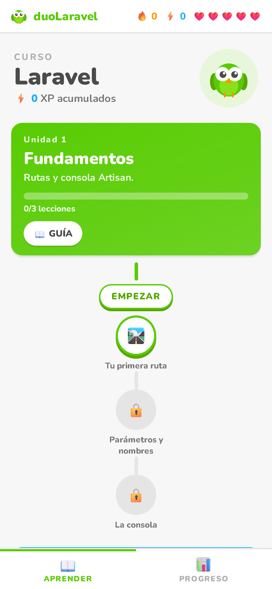
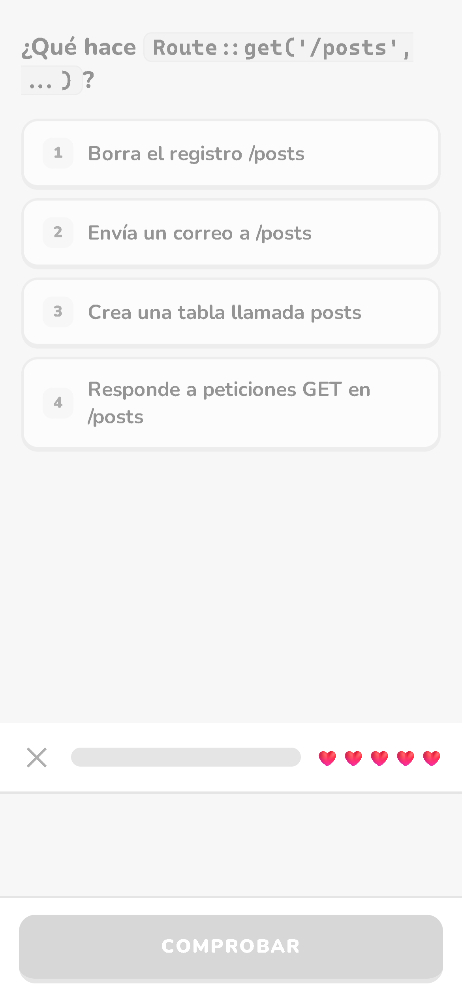
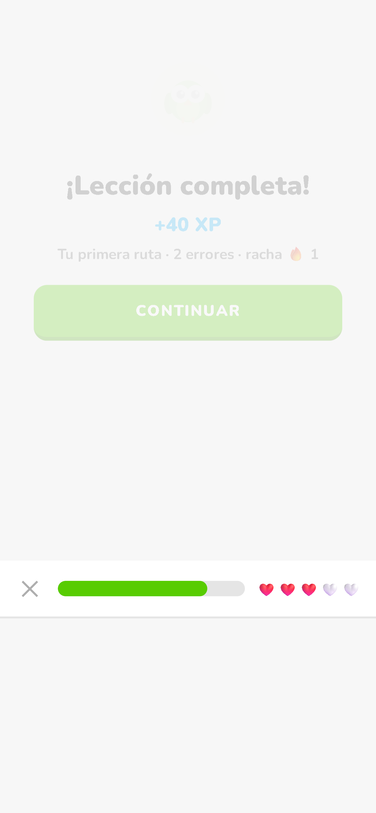

<div align="center">



# 🦉 duoLaravel

**Clon gamificado de Duolingo construido con Laravel.**

Aprende Laravel (y próximamente más temas) jugando: ruta de aprendizaje con desbloqueo
progresivo, XP, rachas, corazones, gemas, ligas, amigos y logros.


</div>

---

## 📚 Acerca del proyecto

`duoLaravel` es un proyecto **personal y educativo**: una aplicación web gamificada al estilo
Duolingo, construida con **Laravel 13 + Blade + Tailwind** y respaldada por una API REST que
alimenta la [versión Android offline (APK)](https://github.com/Marusan94/duolaravel-apk).

Todo el contenido (unidades → habilidades → lecciones → ejercicios) vive en la base de datos,
de modo que **agregar más temas y cursos es solo sembrar contenido**, sin tocar código.

| | |
|:---:|:---:|
|  |  |
| *Ejercicios con feedback inmediato* | *Lección completada: XP + racha* |

## ✨ Características

- 🗺️ **Ruta de aprendizaje** con desbloqueo progresivo (unidades → habilidades → lecciones)
- ✍️ **5 tipos de ejercicio**: selección, traducción, rellenar, ordenar palabras y emparejar
- 🧠 **Motor de respuestas con normalización**: minúsculas, sin acentos ni signos, tolerante a espacios
- ⚡ **XP por acierto + bonus** por completar la lección
- ❤️ **Corazones** que se gastan con errores (con regeneración)
- 🔥 **Rachas diarias** para construir el hábito de estudio
- 💎 **Gemas, tienda e ítems**
- 🏆 **Ligas** con ascensos y descensos semanales
- 👫 **Amigos** y feed de actividad
- 🏅 **Logros** desbloqueables
- 🔔 Notificaciones de la app
- 📱 **APK Android offline** generada desde el mismo currículo ([repo APK](https://github.com/Marusan94/duolaravel-apk))
- 🌐 **PWA instalable** (manifest + íconos propios)
- 🎨 6 temas de color y diseño responsive estilo Duolingo

## 🚀 Inicio rápido

**Requisitos:** PHP 8.3+ · Composer · Node 22 · SQLite (incluido con PHP)

```bash
# 1. Clonar e instalar dependencias
git clone https://github.com/Marusan94/duolaravel.git
cd duolaravel
composer install
npm ci

# 2. Configurar el entorno
cp .env.example .env
php artisan key:generate

# 3. Migrar y sembrar el currículo completo
php artisan migrate --seed

# 4. Compilar assets y levantar el servidor
npm run build
php artisan serve
```

Abre `http://127.0.0.1:8000` y ¡a estudiar! 🎉

**Windows:** también existe `INICIAR-SERVIDOR.cmd` en la raíz del repo, que levanta el servidor en un paso.

## 🧪 Tests

```bash
php artisan test
```

| Suite | Resultado |
|---|---|
| Flujo de lecciones (5 tipos de ejercicio), XP + rachas + corazones, API y auth | ✅ 40 tests, 129 assertions |

## 📱 Versión Android (APK)

La misma base de datos se exporta a `content.js` y se empaqueta con **Capacitor 8**:

```bash
php export-offline.php   # genera ../duo-mobile/www/content.js desde la DB
```

Instrucciones y APK lista para descargar en [`duolaravel-apk`](https://github.com/Marusan94/duolaravel-apk).

## 🗂️ Stack

| Capa | Tecnología |
|---|---|
| Backend | Laravel 13 · PHP 8.3+ |
| Frontend web | Blade · Tailwind CSS · Vite |
| Base de datos | SQLite (intercambiable por MySQL/Postgres en `.env`) |
| API móvil | REST (`/api/v1/...`) consumida por la app Capacitor |
| Móvil | Capacitor 8 → APK Android ([repo aparte](https://github.com/Marusan94/duolaravel-apk)) |
| Tests | PHPUnit · 40 tests de features |

## 🗺️ Roadmap (en desarrollo)

- [x] Curso base: Laravel (12 unidades · 39 lecciones · 140 ejercicios)
- [x] Motor gamificado completo (XP, rachas, corazones, gemas, ligas, amigos, logros)
- [x] Exportador offline reproducible (`export-offline.php`) → APK
- [ ] Nuevo curso: Python
- [ ] Nuevo curso: JavaScript
- [ ] Nuevo curso: Inglés
- [ ] Metas diarias configurables
- [ ] Modo oscuro
- [ ] Rankings globales
- [ ] Sonidos y micro-animaciones de gamificación
- [ ] CI en GitHub Actions (tests automáticos)

## 🤝 Contribuir

Las sugerencias de contenido nuevo (cursos, lecciones, ejercicios) son bienvenidas:
1. Haz un fork y crea tu rama: `git checkout -b contenido/curso-x`
2. Agrega el contenido vía *migrations/seeders* (nunca datos hardcodeados)
3. Amplía los tests si aplica y abre un Pull Request

## 📄 Licencia

Distribuido bajo la licencia [MIT](LICENSE).

> **Disclaimer:** proyecto educativo independiente. No está afiliado, patrocinado ni respaldado por
> Duolingo, Inc. ni por Laravel. "Duolingo" y "Laravel" son marcas de sus respectivos propietarios;
> la UI se inspira en la mecánica de gamificación para el aprendizaje sin reutilizar assets oficiales.
